<div align="center">

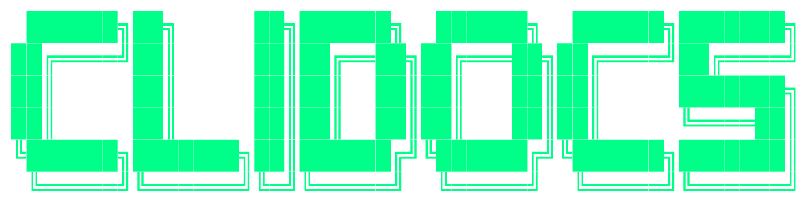

**A terminal-native snippet manager built with Go**

[](https://go.dev)
[](https://www.microsoft.com/windows)
[](https://learn.microsoft.com/powershell)
[](https://neovim.io)

Organize, preview and edit code snippets and Markdown notes in a three-panel TUI.

<!-- IMAGE: uncomment and set the file name

-->

</div>

---

## 1. Installation

### Requirements

| Requirement | Notes |
|---|---|
| **Windows 11 + PowerShell** | Primary supported platform |
| **Neovim (`nvim`)** | Must be in `PATH` to edit files |
| **Git** | Only for the Git sync feature |
| **A Nerd Font** (e.g. JetBrains Mono Nerd Font) | Folder and language icons |
| **Go 1.24+** | Only to build from source |

### Option 1 - One line (recommended)

Run in PowerShell. It downloads `clidocs-installer.exe` from the latest GitHub release into a temporary folder, runs it (the installer downloads and installs `clidocs.exe` from the latest release) and deletes the temporary installer:

```powershell
$i="$env:TEMP\clidocs-installer.exe"; iwr https://github.com/F4NT0/clidocs/releases/latest/download/clidocs-installer.exe -OutFile $i; & $i; Remove-Item $i -Force
```

> The latest release must have `clidocs-installer.exe` attached next to `clidocs.exe`.

### Option 2 - Installer executable

Download `clidocs-installer.exe` from the [releases page](https://github.com/F4NT0/clidocs/releases) and run it, or build it:

```powershell
go build -o clidocs-installer.exe ./cmd/clidocs-installer
.\clidocs-installer.exe
```

### Option 3 - From the cloned repository

```powershell
git clone https://github.com/F4NT0/clidocs.git
cd clidocs
go run . --install
```

> `go run . --install` runs the same installer and installs the **latest published release**, not the local working tree.

### Option 4 - From an installed clidocs

```powershell
clidocs --install      # install or update to the latest release
clidocs --install -y   # skip the confirmation prompt
```

### What the installer does

1. Finds the latest release on GitHub
2. Downloads `clidocs.exe`
3. Verifies the SHA-256 checksum
4. Installs it in `%LOCALAPPDATA%\clidocs`
5. Adds that folder to the user `PATH`
6. Creates the `clidocs` command in PowerShell

Open a **new** terminal afterwards and type `clidocs`. Running the installer again updates an existing install.

<p align="center">
  <!--  -->
</p>

### Uninstall

```powershell
clidocs --uninstall      # asks for confirmation
clidocs --uninstall -y   # skip the confirmation prompt
```

Removes the PowerShell alias, the `PATH` entries and every `clidocs.exe` found on `PATH`. Folders are removed only when empty. **Your snippets are never deleted.**

<p align="center">
  <!--  -->
</p>

---

## 2. Commands

| Command | Description |
|---|---|
| `clidocs` | Start with the splash screen (default snippets directory or browse for another) |
| `clidocs .` | Open the current directory as the snippets root |
| `clidocs <path>` | Open a specific directory, skipping the splash screen |
| `clidocs --help` | Interactive help with one tab per topic (`-h`, `help`) |
| `clidocs --version` | Print the installed version (`-v`, `version`) |
| `clidocs --install` | Install or update from the latest GitHub release |
| `clidocs --uninstall` | Remove clidocs from the computer |

<p align="center">
  <!--  -->
</p>

<p align="center">
  <!--  -->
</p>

---

## 3. Interface

### Start screen

This is the start screen of the program, shown when you run the `clidocs` command without arguments. Use `Up` / `Down` to choose between opening the default snippets directory or browsing for another directory, `Enter` to confirm and `Ctrl+C` to quit.

<p align="center">
  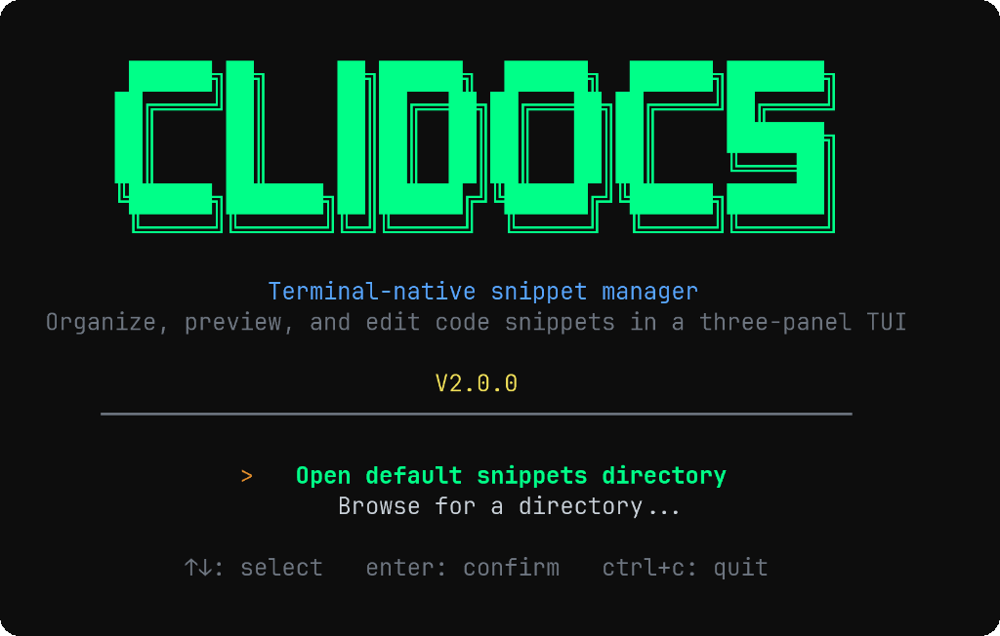
</p>

### Main screen

This is the main screen of the program, shown after you choose a directory. It is empty on first use: press `n` in the Folders panel to create your first folder. The bar at the bottom lists the shortcuts of the active panel.

The screen is split into three panels. `Tab` moves between them and the active panel has a blue border.

| Panel | What it does |
|---|---|
| **Folders** | Lists the folders and subfolders of the snippets directory. Folders with subfolders show a `>` marker; favorites show a star. |
| **Files** | Lists the files of the selected folder with the language tag and the age of each file. |
| **Preview** | Shows the selected file with syntax highlighting, or rendered Markdown (tables, lists, TODO colors and icons). |

<p align="center">
  
</p>

---

## 4. Panels and shortcuts

### Global shortcuts

| Key | Action |
|---|---|
| `Tab` | Next panel |
| `s` | Jump to the Folders panel |
| `g` | Sync snippets with Git |
| `G` | Edit the Git configuration |
| `:` | Open the command console |
| `q` / `Ctrl+C` | Quit |

### Folders panel

Shows the folders of the snippets directory. Moving the cursor updates the Files and Preview panels. `Enter` on a folder with subfolders enters **parent-view**: the first row is `~/` (the files of the folder itself) followed by one row per subfolder. `Left` goes back one level.

<p align="center">
  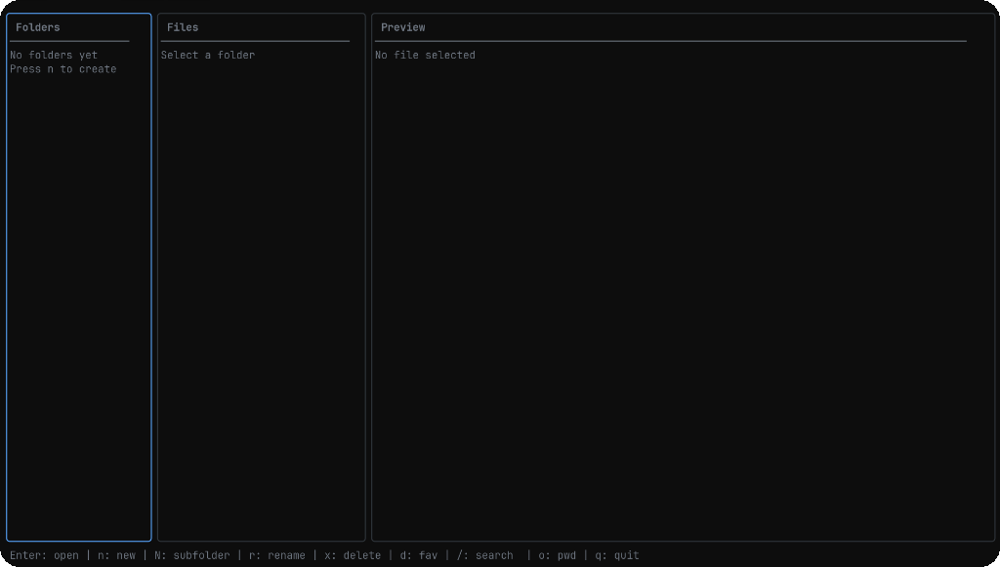
</p>

| Key | Action |
|---|---|
| `Up` / `k`, `Down` / `j` | Move the cursor |
| `Enter` / `Right` / `l` | Open the folder (enters parent-view if it has subfolders) |
| `Left` / `h` | Go back one level |
| `n` | New folder |
| `N` | New subfolder inside the selected folder |
| `r` | Rename the selected folder |
| `d` | Delete the selected folder (confirmation required) |
| `D` | Multi-delete mode: `Space` selects, `D` confirms, `Esc` cancels |
| `/` | Search folders recursively |
| `f` | Favorite / unfavorite the selected folder |
| `F` | Open the favorites list |
| `H` | Return to the original snippets directory |
| `o` | Show information about the snippets directory |

### Files panel

Shows the files of the selected folder. The title shows how many snippets there are. Each row has the language tag, the file name and the folder with the file age.

<p align="center">
  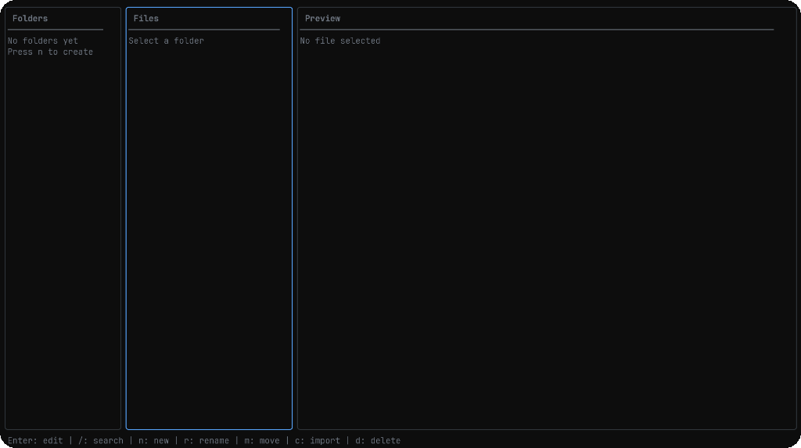
</p>

| Key | Action |
|---|---|
| `Up` / `k`, `Down` / `j` | Move the cursor (the Preview updates live) |
| `Enter` / `e` | Open the file in Neovim |
| `n` | New file |
| `r` | Rename the selected file |
| `d` | Delete the selected file (confirmation required) |
| `m` | Move the file to another folder |
| `c` | Import a file from anywhere with the file picker |
| `/` | Filter files by name (supports globs such as `*.go`) |

### Preview panel (snippet)

Shows the content of the selected file. Code is highlighted with the GitHub Dark theme and Markdown is rendered with styled headings, lists and tables.

<p align="center">
  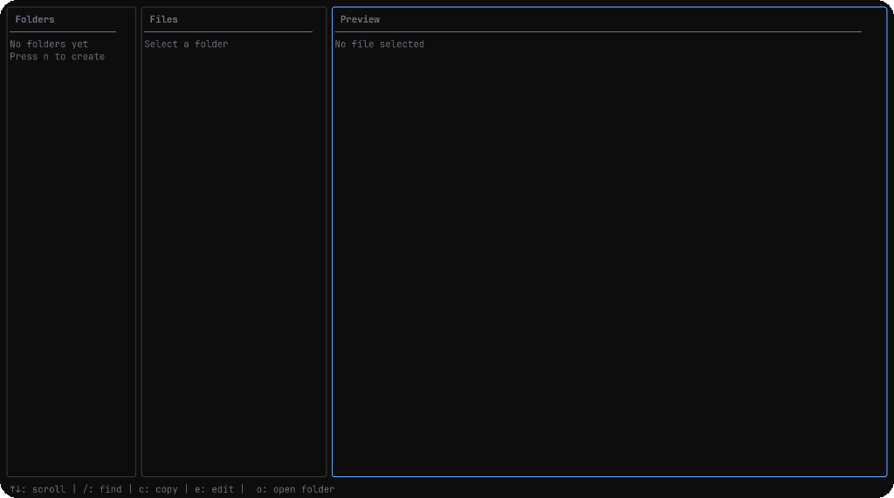
</p>

| Key | Action |
|---|---|
| `Up` / `k`, `Down` / `j` | Scroll |
| `c` | Copy the whole file to the clipboard |
| `e` | Edit the file in Neovim |
| `o` | Open the file location in Windows Explorer |
| `z` | Toggle zoom (preview fills the screen) |
| `L` | Toggle line numbers |
| `/` | Search a word in the file; `Enter` finds matches, then `n` / `N` jump between them |

---

## 5. How to use

<p align="center">
  
</p>

### Create folders and subfolders

1. Focus the **Folders** panel.
2. Press `n`, type the name and press `Enter` to create a folder.
3. Select a folder and press `N` to create a **subfolder** inside it.
4. `Esc` cancels.

<p align="center">
  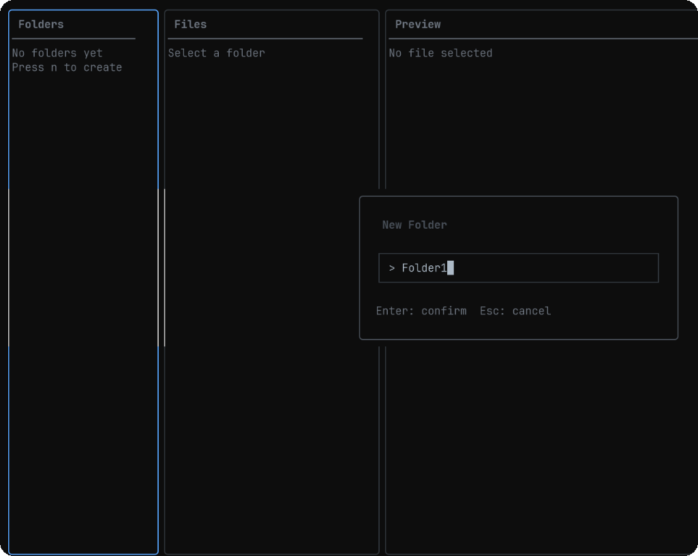
</p>

To create a subfolder, select the parent folder and press `N`. The dialog shows which folder the new subfolder will be created in (`Inside: Folder1/`). Folders that contain subfolders show a `>` marker in the list.

<p align="center">
  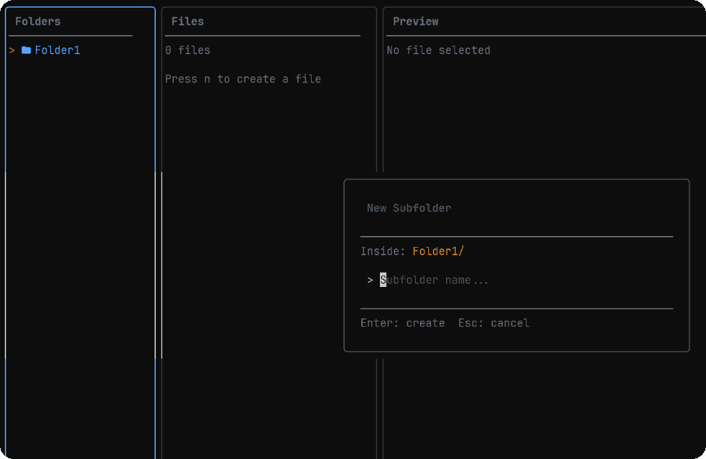
</p>

### Rename a folder

The rename option is only available when the **Folders** panel is focused (use `s` or `Tab` to get there).

1. Select the folder in the Folders panel.
2. Press `r`. A dialog shows the current name (`Current: Folder1/`) and an input pre-filled for the new name.
3. Type the new name and press `Enter` to confirm, or `Esc` to cancel.

<p align="center">
  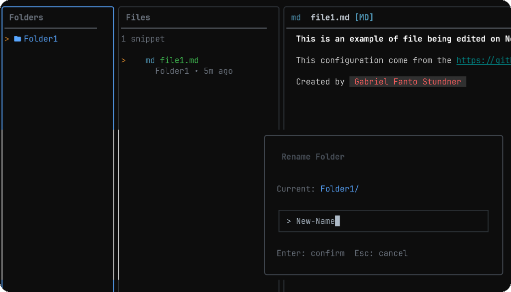
</p>

### Favorite a folder

Favorites are only available when the **Folders** panel is focused.

1. Select the folder in the Folders panel.
2. Press `f`. A star appears next to the folder name.
3. Press `f` again on the same folder to remove the star.
4. Press `F` (capital) to open the favorites list.

<p align="center">
  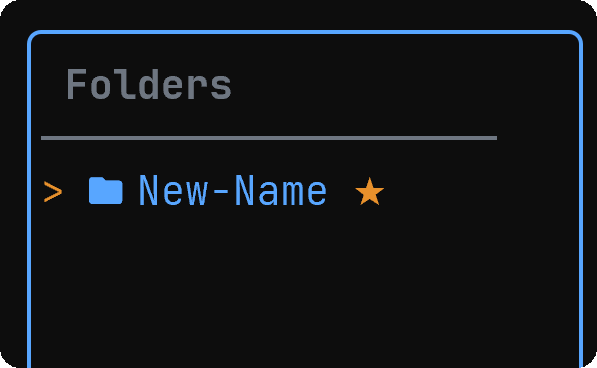
</p>

In the favorites list use `Up` / `Down` to navigate, `Enter` to go to the folder, `o` to open it in Explorer, `f` to remove it from the favorites and `Esc` to close.

<p align="center">
  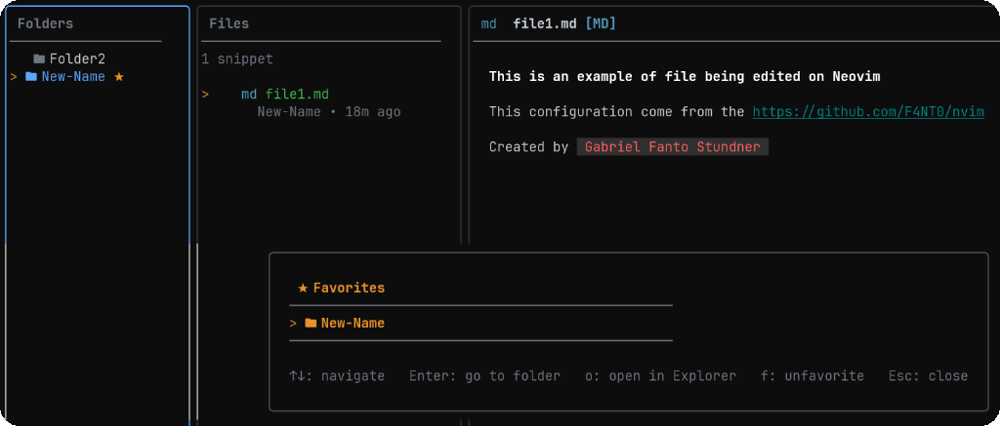
</p>

### Delete folders

Deleting folders is only available when the **Folders** panel is focused. Deleting a folder removes everything inside it.

- **One folder:** select it and press `d`. A dialog asks for confirmation and warns that the folder and all its contents will be deleted and that this cannot be undone. Press `Enter` or `y` to delete, or `Esc` or `n` to cancel.

<p align="center">
  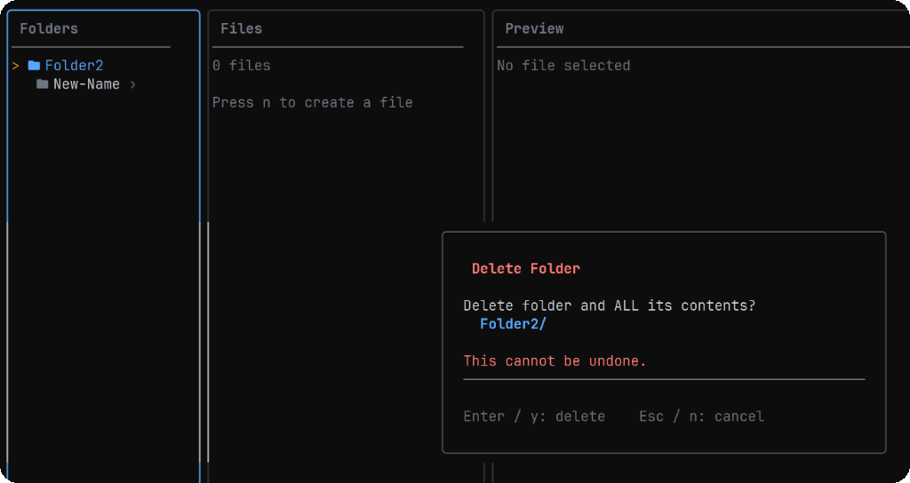
</p>

- **Several folders:** press `D` to enter multi-delete mode, move with `Up` / `Down`, press `Space` to select or deselect each folder, press `D` again to confirm and `Esc` to cancel. The selected folders are highlighted in red. A dialog shows how many folders will be deleted and warns that this cannot be undone. Press `Enter` or `y` to delete, or `Esc` or `n` to cancel.

<p align="center">
  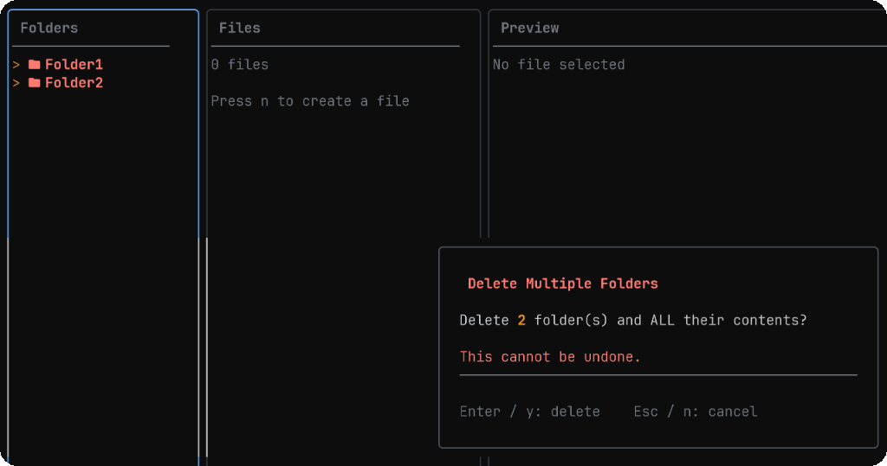
</p>

<p align="center">
  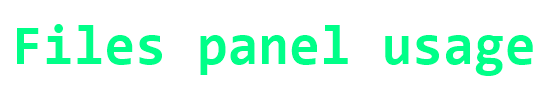
</p>

### Create files inside a folder

1. Select a folder and focus the **Files** panel with `Tab`.
2. Press `n`.
3. Type the file name (without extension) and press `Enter` or `Tab`.
4. Type the extension (for example `go`, `py`, `md`) and press `Enter`. The file is created and opened in Neovim.

<p align="center">
  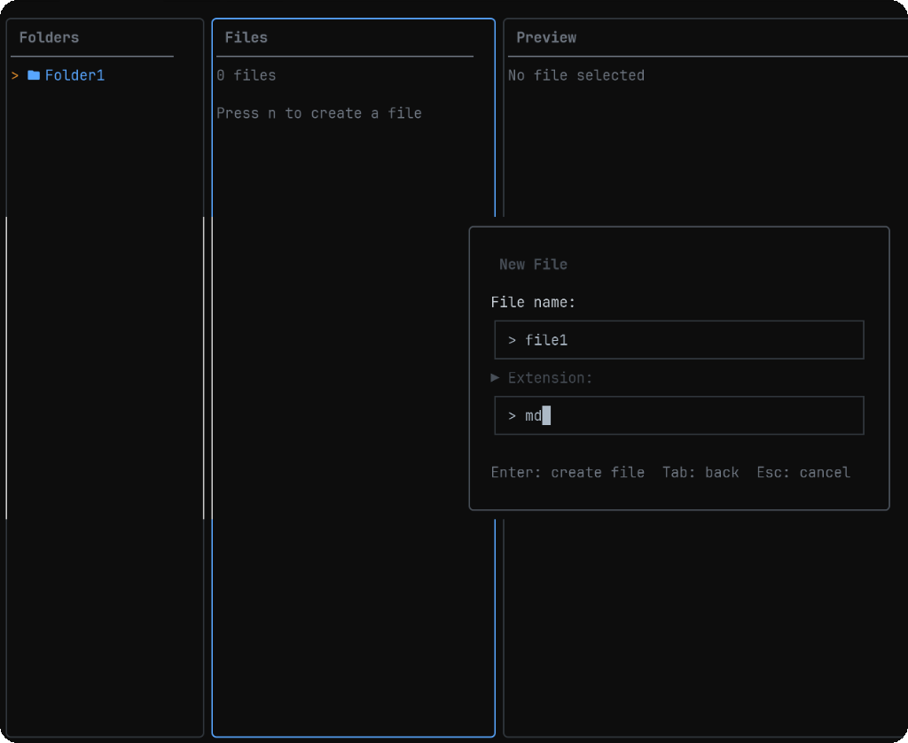
</p>

### Edit files

Press `Enter` or `e` on a file (Files panel) or `e` (Preview panel) to open it in Neovim. Save with `:w`, quit with `:q`, or both with `:wq`. When you return to clidocs the preview is refreshed. In the console, the `nvim` command shows a Neovim quick reference.

<p align="center">
  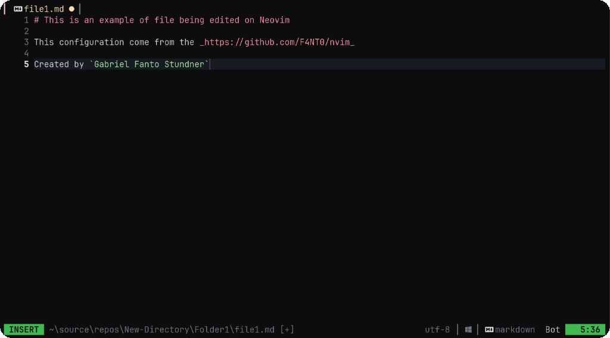
</p>

### Snippet panel after saving

After you save and quit Neovim (`:wq`), clidocs shows the result right away. The Files panel lists the snippet with its language tag, folder and age, and the Preview panel (the snippet panel) shows the saved content: Markdown is rendered with styled text and links, and code files are syntax highlighted. From here you can scroll, search (`/`), copy (`c`), edit again (`e`) or open the folder (`o`).

<p align="center">
  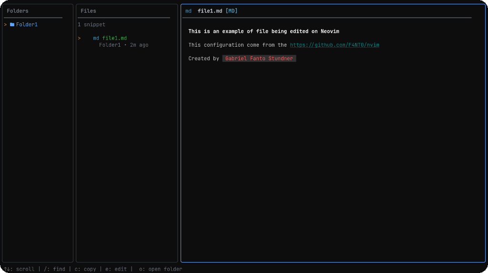
</p>

### Rename a file

The rename option is only available when the **Files** panel is focused (use `Tab` to get there).

1. Select the file in the Files panel.
2. Press `r`. A dialog shows the current name (`Current: File1.md`) and an input pre-filled with it, extension included.
3. Type the new name and press `Enter` to confirm, or `Esc` to cancel.

<p align="center">
  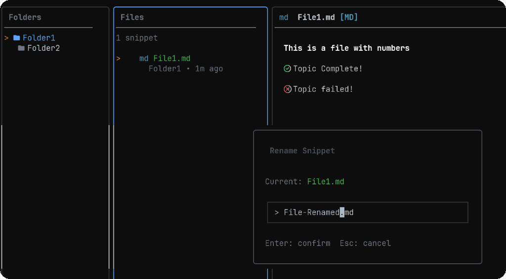
</p>

### Move a file

Moving files is only available when the **Files** panel is focused.

1. Select the file in the Files panel.
2. Press `m`. A dialog shows the file name and the list of folders and subfolders you can move it to.
3. Use `Up` / `Down` to choose the destination folder. The last entry, `Browse external folder...`, lets you pick a folder outside the snippets directory.
4. Press `Enter` to move the file, or `Esc` to cancel.

<p align="center">
  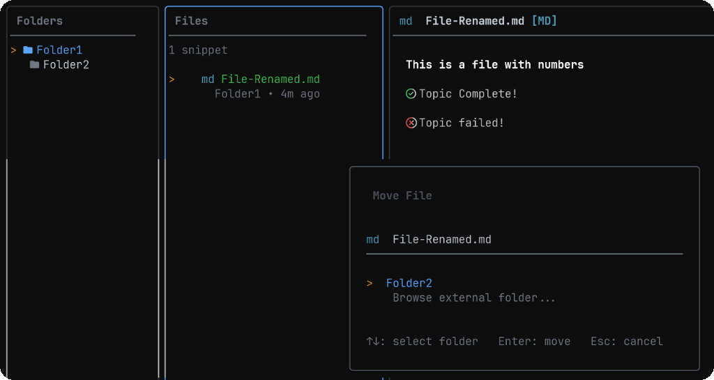
</p>

### Import a file

Importing files is only available when the **Files** panel is focused.

1. Select the folder that will receive the files and focus the Files panel.
2. Press `c`. clidocs opens the Windows file picker (the Windows file explorer window) and shows the message `Opening file picker...`.
3. In the picker, select one or more files and confirm. They are copied into the current folder (`Folder1` in the example).

<p align="center">
  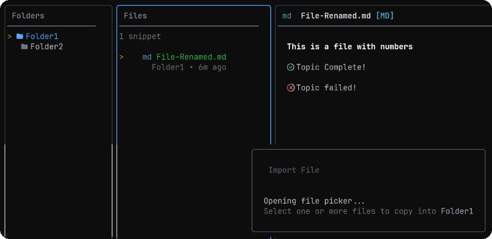
</p>

### Delete files

Deleting files is only available when the **Files** panel is focused.

1. Select the file in the Files panel.
2. Press `d`. A dialog asks `Are you sure you want to delete:` and shows the file name.
3. Press `Enter` or `y` to delete, or `Esc` or `n` to cancel.

<p align="center">
  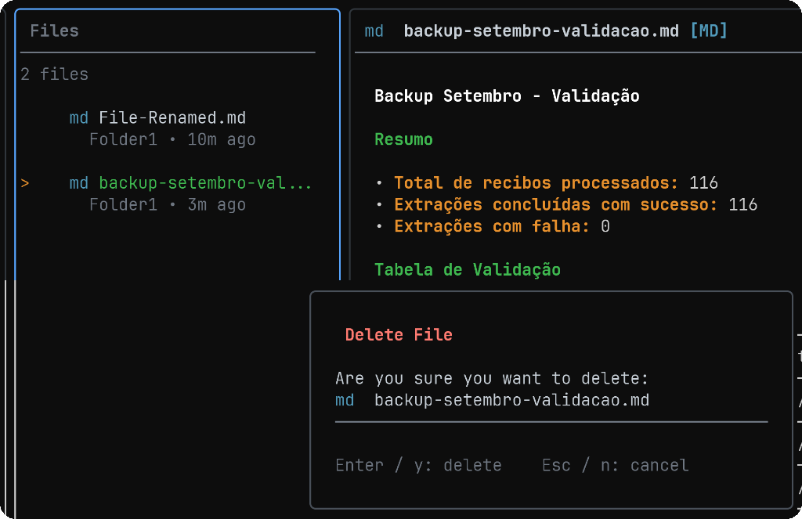
</p>

---

<p align="center">
  
</p>

The `/` key starts a search in every panel. What it searches depends on which panel is focused.

### Folder search

Available when the **Folders** panel is focused.

1. Press `/`. A search dialog opens and lists the folders, including subfolders.
2. Type part of a folder name. The list is filtered while you type.
3. Use `Up` / `Down` to choose a result and press `Enter` to jump to that folder.
4. Press `Esc` to close the search without changing anything.

<p align="center">
  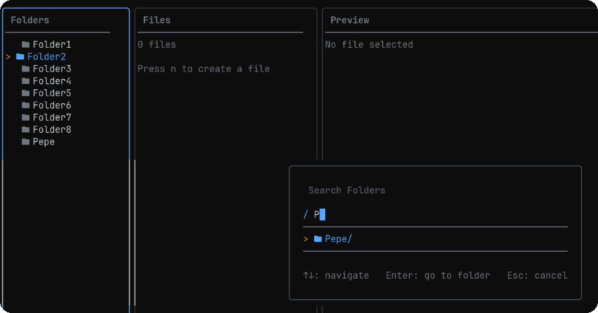
</p>

### File search

Available when the **Files** panel is focused.

1. Press `/`. A search bar replaces the panel title.
2. Type part of a file name. The file list is filtered while you type and globs such as `*.go` are supported.
3. Use `Up` / `Down` to move through the results. The Preview panel updates live.
4. Press `Enter` to keep the selection, or `Esc` to cancel and restore the full list.

<p align="center">
  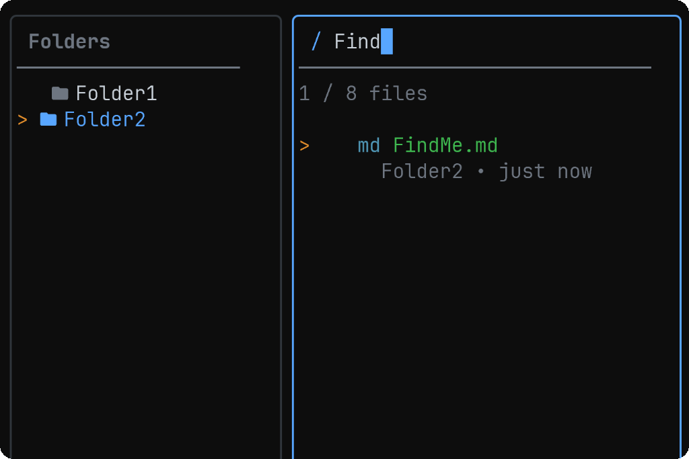
</p>

### Preview search

Available when the **Preview** panel is focused and a file is loaded. It searches words inside the file content.

1. Press `/`. A search bar appears.
2. Type the word or phrase, including the letter `n`, and press `Enter`. Every match is shown in **bold green** inside the text. In code files the lines with matches are also marked: the current one with an orange arrow and the others with a green dot.
3. After the first `Enter`, press `n` to jump to the next match and `N` to jump to the previous one.
4. Press `Esc` to close the search.

<p align="center">
  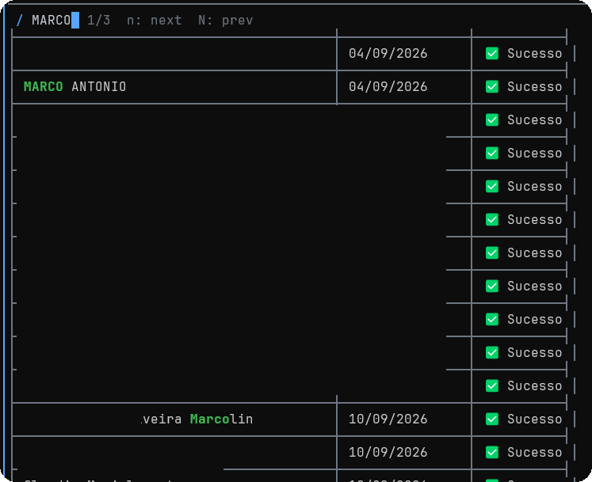
</p>

---

<p align="center">
  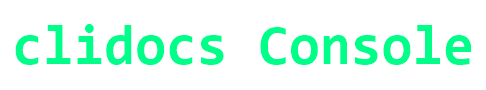
</p>

### Git sync

Press `g` to sync the snippets directory with a Git repository. The first time, a dialog asks for the remote; `G` edits the configuration later. Git must be installed.

### Console

Press `:` on the main screen to open the console (`Cmdline`). Type a command and press `Enter`. `Esc` closes the console, and from inside a command screen `Esc` goes back to the console. Unknown commands show `Unknown command` and a hint to type `cmd`.

<p align="center">
  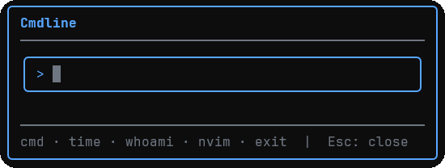
</p>

#### `time`

Work hours calculator. Type your start time as `HH:MM` (for example `08:00`) and press `Enter`. It shows the coffee break, lunch start, lunch end, the normal exit time (8h48 worked) and the maximum exit time (10h worked). `Enter` goes back to the console.

First, type the start time in the `HH:MM` field and press `Enter` to calculate (`Esc` goes back).

<p align="center">
  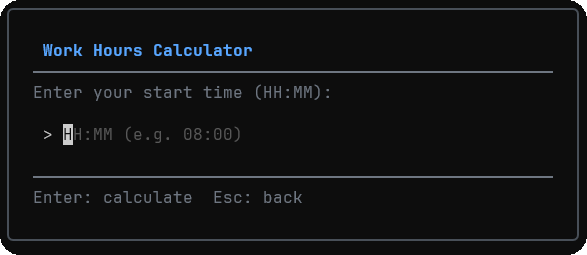
</p>

Then the result is shown. In the example, an entry at `07:01` gives the coffee break at `08:01`, lunch from `11:01` to `12:01`, the normal exit at `16:49` (8h48 worked) and the maximum exit at `18:01` (10h worked).

<p align="center">
  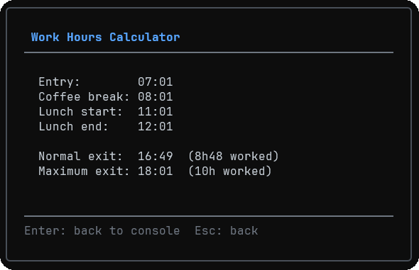
</p>

#### `alive`

Keeps the computer awake. While this screen is open, clidocs presses the `B` key every 2 seconds, so the system does not lock or go idle. The keypress goes to the focused window, so keep clidocs focused while it runs. `Esc` stops it.

<p align="center">
  <!--  -->
</p>

#### `whoami`

Shows information about the author as if a terminal command was run. `Enter` opens the website fantodocs.github.io in the browser, and `Esc` goes back to the console.

<p align="center">
  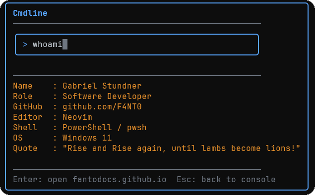
</p>

#### `cmd`

Shows the list of the commands available in the console, each one with a short description of what it does. It has two tabs: "Console commands" and "Neovim Quick Reference". Use `‚Üê`/`‚Üí` or `Tab` to switch tabs, `1`/`2` to jump directly, and `‚Üë`/`‚Üì` to scroll. `Enter` or `Esc` goes back to the console. The keyboard shortcuts of the panels are in the help panel, opened with `?` on the main screen.

<p align="center">
  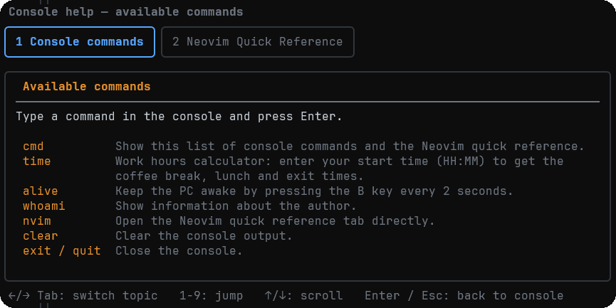
</p>

#### `nvim`

Opens the same help as `cmd`, but directly on the "Neovim Quick Reference" tab. It shows navigation, editing, save and quit, search, commenting and uncommenting several lines, and visual mode. Use `‚Üê`/`‚Üí` or `Tab` to switch to the "Console commands" tab. `Enter` or `Esc` goes back to the console.

<p align="center">
  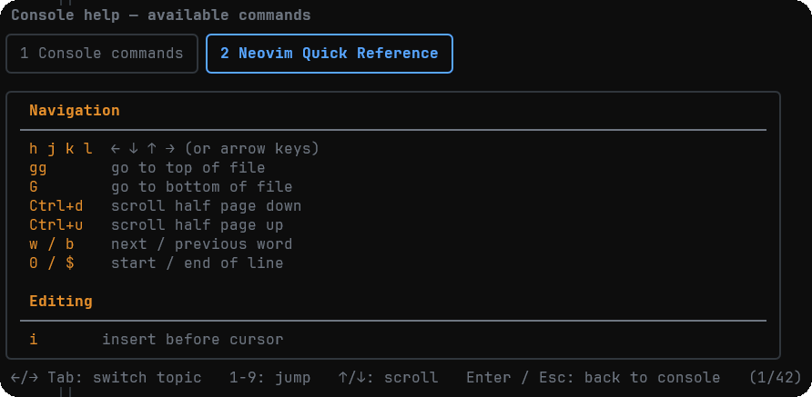
</p>

#### `ls` and `cd`

`ls` opens a floating panel with a tree view of the directories inside the directory currently open in clidocs (up to 3 levels, hidden folders skipped). Use `‚Üë`/`‚Üì` to scroll. In the panel, type `cd <directory>` (for example `cd Projects` or `cd Projects/App`) and press `Enter`: the panel closes and the Folders and Files panels show the chosen directory. `Esc` goes back to the console. In the console, `cd <directory>` also works directly, and `cd ..` goes to the parent directory.

<p align="center">
  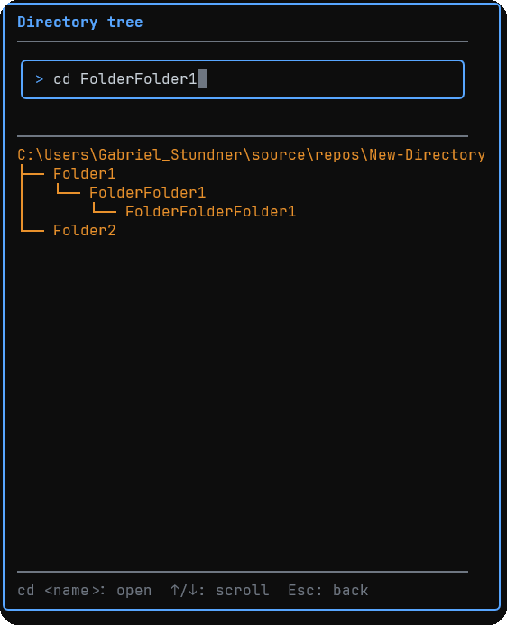
</p>

#### `exit`

Closes clidocs completely (`quit` does the same).

---

## Project structure

```
clidocs/
+-- cmd/
¶   +-- clidocs-installer/   # clidocs-installer.exe (downloads and installs the latest release)
¶   +-- install/             # Legacy local installer
+-- internal/installer/      # Installer TUI shared by --install and clidocs-installer
+-- scripts/                 # Helper scripts (round-images.ps1, make-title.ps1)
+-- docs/                    # Extra documentation
+-- images/                  # README images
+-- main.go                  # Entry point, CLI flags and version
+-- model.go, view.go, update.go   # Core Bubble Tea application
+-- splash.go, dirbrowser.go       # Start screen and directory browser
+-- folder.go, file.go, filecopy.go, dirs.go   # Folder and file operations
+-- search.go, searchhl.go   # Search and preview match highlighting
+-- highlight.go, imagepreview.go, icons.go    # Syntax highlighting, image preview, icons
+-- git.go, gitconfig.go     # Git sync
+-- console.go, alive.go, other.go   # Console commands (ls, cd, time, alive, whoami)
+-- helpcmd.go               # clidocs --help, ? panel and console cmd help
+-- uninstall.go             # clidocs --uninstall
+-- styles.go                # Colors and styles
```

## Dependencies

| Package | Purpose |
|---|---|
| `github.com/charmbracelet/bubbletea` | TUI framework |
| `github.com/charmbracelet/bubbles` | Text input and progress bar components |
| `github.com/charmbracelet/lipgloss` | Layout and styling |
| `github.com/charmbracelet/glamour` | Markdown rendering |
| `github.com/alecthomas/chroma/v2` | Syntax highlighting |
| `github.com/atotto/clipboard` | Clipboard support |

```bash
go mod tidy
```
